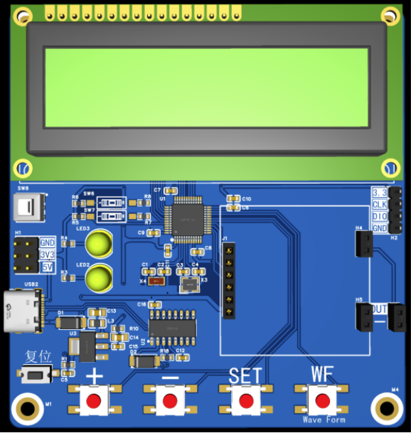
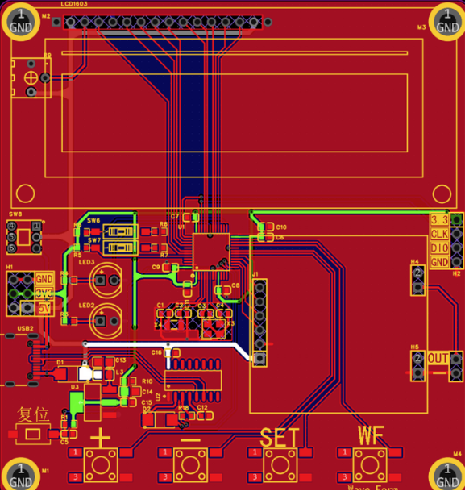
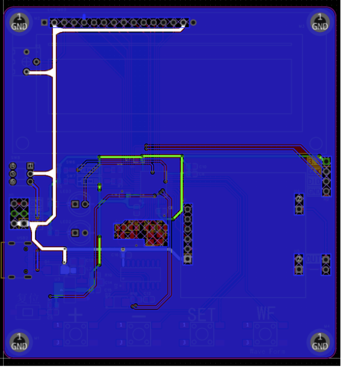

# Embedded STM32 Signal Generator
> Graduation Design Project — STM32 DDS Signal Generator based on AD9833

## Features
1. Generate sine wave, square wave, triangle wave
2. Adjustable output frequency
3. DDS waveform generation using AD9833 chip

## Development Environment
- Keil MDK
- STM32F103 MCU, Standard Peripheral Library
- AD9833 DDS waveform generator

## Project Structure
- CORE: Core startup files
- HAREWARE: Hardware peripheral drivers
- STM32F10x_FWLib: STM32 standard library
- SYSTEM: Low-level system functions (delay, serial port)
- USER: Main program and AD9833 waveform logic
- docs: Schematic PDF and demonstration images

## Schematic Document
[SCH_Schematic1_2025-11-13.pdf](./docs/SCH_Schematic1_2025-11-13.pdf)

## Demo Images

## Description
This graduation design implements a multi-function signal generator.
The main controller is STM32F103, and AD9833 is used to realize DDS waveform output.
The system can output different types of waveforms with adjustable frequency.

> Note: This project is for graduation design display.
